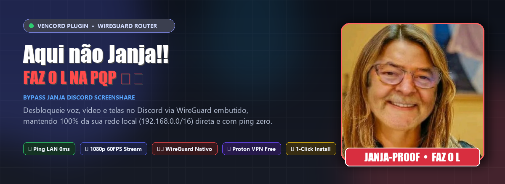
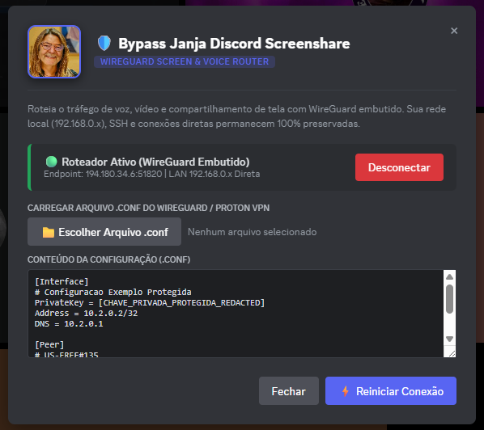
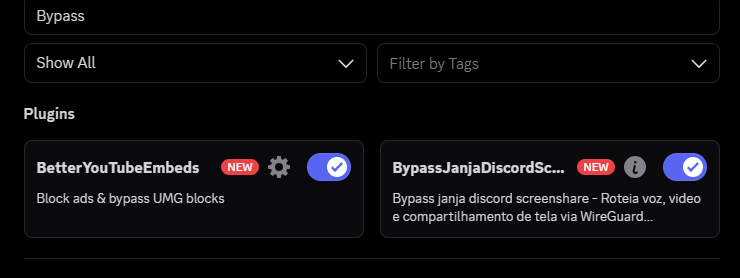

# Bypass Janja Discord Screenshare

<p align="center">
  
</p>

<p align="center">
  <a href="https://github.com/eojonathanoliveira/bypass-janja-discord-screenshare/releases"></a>
  <a href="https://vencord.dev/"></a>
  <a href="https://www.wireguard.com/"></a>
  <a href="https://account.protonvpn.com/downloads"></a>
  <a href="#"></a>
  <a href="#"></a>
  <a href="LICENSE"></a>
</p>

> Roteamento inteligente e dedicado de voz, vídeo e compartilhamento de tela via WireGuard para clientes Discord modificados (Vencord). *Aqui não Janja! FAZ O L NA PQP!*

---

## 🎯 Sobre o Projeto

O **Bypass Janja Discord Screenshare** é uma solução definitiva para resolver problemas de instabilidade, tela preta e carregamento infinito em transmissões de tela e chamadas de voz no Discord, frequentemente causados por rotas instáveis de operadoras ou bloqueios de tráfego UDP/WebRTC.

O plugin integra um túnel WireGuard embutido diretamente ao cliente Discord, aplicando um roteamento dividido (*split-tunneling*) que protege o tráfego de mídia enquanto preserva a rede local (`192.168.0.0/16`) e as demais conexões do computador (SSH, jogos em LAN e ferramentas como Sunshine/Moonlight permanecem 100% diretos e rápidos).

---

## 📋 Pré-requisitos do Sistema

Para utilizar o **Bypass Janja Discord Screenshare**, você precisará do cliente **Discord Desktop**, do modificador **Vencord** e do motor de rede **WireGuard** instalados no computador.

Você pode instalar os 3 pré-requisitos em **1 linha de comando** via `winget` (Prompt de Comando ou PowerShell) ou baixá-los diretamente pelos sites oficiais:

```cmd
winget install Discord.Discord Vendicated.Vencord WireGuard.WireGuard
```

### Links Oficiais e Instalação Individual:

| Software | Descrição | Link Oficial (Fonte) | Comando Winget |
| :--- | :--- | :--- | :--- |
| **Discord Desktop** | Cliente oficial do Discord para Windows | 🌐 [discord.com/download](https://discord.com/download) | `winget install Discord.Discord` |
| **Vencord** | Modificador de cliente leve para Discord | 🌐 [vencord.dev/download](https://vencord.dev/download) | `winget install Vendicated.Vencord` |
| **WireGuard** | Motor de túnel e roteamento de rede | 🌐 [wireguard.com/install](https://www.wireguard.com/install/) | `winget install WireGuard.WireGuard` |

> [!TIP]
> O script de instalação `install.bat` também detecta e instala o WireGuard automaticamente caso você ainda não o tenha.

---

## 🆓 Onde conseguir configurações WireGuard gratuitas (Proton VPN)

Você pode usar qualquer servidor WireGuard, mas o **Proton VPN oferece configurações WireGuard 100% gratuitas e rápidas**:

1. Acesse: **[account.protonvpn.com/downloads](https://account.protonvpn.com/downloads)** (ou faça login no Proton e vá na seção de Downloads / WireGuard Configuration).
2. Escolha o sistema operacional (**Windows**) e selecione qualquer um dos servidores gratuitos disponíveis (ex: Estados Unidos, Holanda, Japão).
3. Clique em **Download** para baixar o arquivo `.conf`.
4. No Discord, entre em qualquer chamada, clique no ícone do escudo do **Bypass Janja Discord Screenshare** e carregue o arquivo `.conf` (ou cole o texto da configuração).
5. O plugin cuidará de tudo automaticamente: ativará o túnel embutido, excluirá a rede local e garantirá que sua transmissão funcione lisa!

---

## 🚀 Como Instalar (3 Formatos)

### Formato 1: Modo Rápido (Extrair e Reiniciar) ⭐ RECOMENDADO

Não precisa rodar nenhum comando se não quiser!

1. Baixe o pacote **`bypass-janja-discord-screenshare.zip`** na [página de Releases](https://github.com/eojonathanoliveira/bypass-janja-discord-screenshare/releases).
2. Pressione as teclas **`Windows + R`**, digite:
   ```text
   %APPDATA%\Vencord
   ```
   e clique em **OK** (isso abrirá a pasta base do Vencord).
3. **Extraia todo o conteúdo do ZIP diretamente dentro dessa pasta** `%APPDATA%\Vencord\` (substitua os arquivos se o Windows perguntar).
4. Reinicie o Discord (ou pressione `Ctrl + R` dentro dele).
5. **Pronto!** Entre em qualquer chamada de voz e o escudo verde já estará disponível na barra de controle.

---

### Formato 2: Instalador em 1 Clique (`install.bat`)

Se preferir automação total:
1. Baixe o repositório ou o ZIP da Release.
2. Dê um **duplo clique no arquivo `install.bat`**.
3. O script verificará o WireGuard (instalando via `winget` se necessário), copiará os arquivos para a pasta do Vencord e ativará o carregador.
4. Reinicie o Discord.

---

### Formato 3: Para Desenvolvedores (Código Oficial Vencord / Pull Request)

Se você compila o Vencord pelo código-fonte ou deseja submeter o plugin para inclusão na lista oficial do Vencord (`Vendicated/Vencord`):

1. Clone o repositório oficial do Vencord:
   ```bash
   git clone https://github.com/Vendicated/Vencord.git
   cd Vencord
   pnpm install
   ```
2. Copie a pasta `src/plugins/wireguardCallRouter` deste repositório para `src/plugins/` (ou `src/userplugins/`) do Vencord.
3. Compile e injete no Discord:
   ```bash
   pnpm build
   pnpm inject
   ```
4. O plugin aparecerá nativamente nas configurações do Discord: **Configurações de Usuário -> Vencord -> Plugins -> BypassJanjaDiscordScreenshare**.

---

## 📸 Demonstração da Interface

### 1. Painel de Controle do Bypass Janja Discord Screenshare
Acessível pelo ícone de escudo na chamada, com indicador em tempo real, status de conexão e botão de desconexão em 1 clique:



### 2. Botão Integrado aos Controles de Voz
O ícone do escudo se integra à barra de controle de voz do Discord, ao lado dos controles de desconexão, exibindo status ativo em verde:


### 3. Integração Nativa no Catálogo de Plugins do Vencord
O plugin é reconhecido nativamente pelo Vencord em **Configurações de Usuário -> Vencord -> Plugins**. Você pode ativá-lo ou desativá-lo com 1 clique diretamente pelo seletor nativo:



---

## 🏗️ Como Funciona o Roteamento

```text
[ Discord Voice & Video (WebRTC) ] ──▶ [ WireGuard Tunnel ] ──▶ [ Rota Segura VPN ]
[ Jogos, Navegador & Internet   ] ──────────────────────────▶ [ Conexão Direta ]
[ Rede Local (192.168.0.x / LAN) ] ──────────────────────────▶ [ Roteador Local Direto ]
```

- **Auto-Atualização Contínua (OTA)**: O plugin verifica novas versões lançadas no GitHub automaticamente em segundo plano (na inicialização e a cada 6 horas) ou manualmente pelo botão "Verificar Atualizações" no rodapé do modal, mantendo seu Vencord sempre com a versão mais recente sem precisar reinstalar nada!
- **Apenas Discord por Padrão**: O túnel opera em modo exclusivo para chamadas, streams e voz do Discord (`66.22.192.0/18` + IP dinâmico do servidor ativo). Seus navegadores, downloads, Steam e jogos não passam pela VPN e **sua internet nunca cai** mesmo se a sessão do `.conf` expirar.
- **DNS Intocado e Seguro**: As diretivas de DNS do arquivo `.conf` são ignoradas propositalmente para manter o DNS original da sua máquina intacto, evitando falhas de resolução ao encerrar a VPN.
- **Watchdog Automático**: Se o servidor da VPN desconectar ou a validade expirar, o serviço detecta a ausência de handshake e encerra o túnel automaticamente, restaurando as rotas sem travar nada.
- **Rede Local (LAN) Intacta**: Mantém o range `192.168.0.0/16` 100% direto. Conexões SSH, jogos na rede local e Moonlight/Sunshine funcionam sem qualquer latência ou interferência.
- **FakeNitro Liberado**: Opera sem travas em 1080p / 60fps / Fonte.

---

## 📦 Estrutura de Arquivos no Vencord

Quando extraído em `%APPDATA%\Vencord\`, todos os arquivos ficam organizados diretamente na pasta base do Vencord:

```text
%APPDATA%\Vencord\
├── loader.js                      # Carregador, auto-updater e ponte IPC Electron
├── version.json                   # Controle de versão semântica e atualização OTA
├── proton_vpn_service.js          # Gerenciador do motor WireGuard e rotas
├── proton_vpn_ui.js               # Componente de interface nativa e painel
├── proton_vpn.example.conf        # Modelo de configuração de exemplo
├── install.bat                    # Atalho do instalador em 1 clique
├── install.ps1                    # Script PowerShell de automação
├── assets\
│   ├── banner_header.png          # Banner do repositório
│   ├── modal_router.png           # Captura do painel do roteador
│   ├── voice_control_bar.png      # Captura do botão na barra de voz
│   ├── vencord_plugins_view.png   # Captura da lista nativa de plugins
│   └── janja_burra.webp           # Ícone do cabeçalho do plugin
├── bin\
│   ├── wireguard.exe              # Motor WireGuard standalone
│   └── wg.exe                     # Utilitário de linha de comando
└── dist\
    ├── patcher.js                 # Patcher do Vencord com gancho de inicialização
    └── renderer.js                # Bundle compilado do Vencord com plugin registrado
```

---

## 🤖 Prompt para Instalação Automatizada por I.A.

Copie e envie o prompt abaixo para seu assistente de Inteligência Artificial (ChatGPT, Claude, Cursor, Copilot, Antigravity, etc.) para instalação 100% automatizada no Windows (não requer Git instalado):

```text
Você é um assistente técnico de automação no Windows. Execute a instalação e configuração do projeto "Bypass Janja Discord Screenshare" nesta máquina seguindo com rigor as etapas abaixo:

1. Verifique se o WireGuard está instalado. Se não estiver, instale-o via winget:
   winget install WireGuard.WireGuard --accept-package-agreements --accept-source-agreements --silent

2. Baixe o pacote oficial da release e extraia diretamente na pasta do Vencord (funciona mesmo sem Git):
   $zipUrl = "https://github.com/eojonathanoliveira/bypass-janja-discord-screenshare/releases/latest/download/bypass-janja-discord-screenshare.zip"
   $zipPath = "$env:TEMP\bypass-janja.zip"
   Invoke-WebRequest -Uri $zipUrl -OutFile $zipPath
   Expand-Archive -Path $zipPath -DestinationPath "$env:APPDATA\Vencord" -Force

3. Garanta que os binários do WireGuard estejam presentes em "$env:APPDATA\Vencord\bin\":
   - O pacote já inclui os binários standalone. Caso necessário, copie wireguard.exe e wg.exe de "C:\Program Files\WireGuard\" para "$env:APPDATA\Vencord\bin\".

4. Verifique o gancho de inicialização no patcher do Vencord:
   - No arquivo "$env:APPDATA\Vencord\dist\patcher.js", garanta que a primeira linha contenha:
     try { require("../loader.js"); } catch (e) {}

5. Reinicie o Discord:
   - Finalize os processos do Discord: Stop-Process -Name Discord -Force -ErrorAction SilentlyContinue
   - Inicie o Discord novamente via "$env:LOCALAPPDATA\Discord\Update.exe --processStart Discord.exe"

6. Informe ao usuário que a instalação foi concluída com sucesso! Para obter um arquivo .conf gratuito, basta acessar account.protonvpn.com/downloads.
```

---

## 🔒 Privacidade e Segurança

- **Nenhuma chave privada é versionada**: Arquivos `.conf` locais são explicitamente ignorados pelo `.gitignore`.
- O repositório contém apenas modelos com chaves fictícias (`proton_vpn.example.conf`).
- O modal sanitiza chaves privadas na interface gráfica para capturas de tela seguras.

---

## 📄 Licença

Distribuído sob a licença MIT. Consulte `LICENSE` para mais informações.
