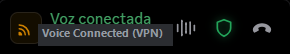

# Discord WireGuard Call Router

> Roteamento inteligente e dedicado de voz, vídeo e compartilhamento de tela via WireGuard para clientes Discord modificados (Vencord).

---

## 🎯 Sobre o Projeto

O **Discord WireGuard Call Router** é uma solução desenvolvida para resolver problemas de instabilidade, tela preta e carregamento infinito em transmissões de tela e chamadas de voz no Discord, frequentemente causados por rotas instáveis de operadoras ou bloqueios de tráfego UDP/WebRTC.

O plugin integra um túnel WireGuard embutido diretamente ao cliente Discord, aplicando um roteamento dividido (*split-tunneling*) que protege o tráfego de mídia enquanto preserva a rede local e as demais conexões do computador.

---

## 🚀 Principais Recursos

- **⚡ Motor WireGuard Embutido**: Não depende do aplicativo desktop do WireGuard aberto. O serviço é gerenciado diretamente pelo plugin.
- **🛡️ Roteamento de Mídia Dedicado**: Direciona o tráfego WebRTC (voz, vídeo e compartilhamento de tela) pelo túnel configurado.
- **🏠 Rede Local (LAN) Intacta**: Mantém o range `192.168.0.0/16` 100% direto, garantindo que conexões SSH, jogos na rede local e ferramentas como Moonlight/Sunshine funcionem sem interferência.
- **🎨 Interface Integrada ao Discord**: Adiciona um botão nativo com ícone de escudo na barra de controles de voz, com indicador de status visual em tempo real.
- **💎 Compatibilidade com FakeNitro**: Opera em harmonia com plugins de desbloqueio de resolução (1080p / 60fps / Fonte).
- **🔄 Troca Livre de Servidores**: Não interfere na navegação e permite alternar entre canais e servidores livremente.

---

## 📸 Demonstração da Interface

### 1. Botão Integrado aos Controles de Chamada
O ícone do escudo se integra à barra de controle de voz do Discord, ao lado dos controles de desconexão, exibindo status ativo em verde:



### 2. Painel de Gerenciamento do Roteador
Modal acessível diretamente pelo cliente para importação ou inserção da configuração WireGuard (`.conf`), com verificação de status e desconexão em um clique:


---

## 🏗️ Como Funciona

```text
[ Discord Voice & Video (WebRTC) ] ──▶ [ WireGuard Tunnel ] ──▶ [ Rota Segura ]
[ Jogos, Navegador & Internet   ] ──────────────────────────▶ [ Conexão Direta ]
[ Rede Local (192.168.0.x / LAN) ] ──────────────────────────▶ [ Roteador Local ]
```

1. **Camada de Interface (`proton_vpn_ui.js`)**: Monitora o DOM do cliente e adiciona o botão de ação rápida e modal de configuração.
2. **Camada de Serviço (`proton_vpn_service.js`)**: Comunica-se com o motor WireGuard local, ajusta rotas de rede para excluir a LAN e gerencia a inicialização/parada do serviço.
3. **Carregador Persistente (`loader.js`)**: Mantém as pontes de comunicação IPC ativas entre o processo principal do Electron e a interface.

---

## 📦 Estrutura do Repositório

```text
├── assets/
│   ├── modal_router.png       # Captura sanitizada do painel
│   └── voice_control_bar.png  # Captura do botão na barra de voz
├── plugin/
│   ├── loader.js              # Carregador e ponte IPC Electron
│   ├── proton_vpn_service.js  # Gerenciador do motor WireGuard e rotas
│   └── proton_vpn_ui.js       # Componente de interface nativa
├── proton_vpn.example.conf    # Modelo de configuração de exemplo
├── install.ps1                # Script de instalação para Windows
└── .gitignore                 # Filtro de arquivos locais e temporários
```

---

## 🛠️ Instalação Rápida (Windows)

1. Clone este repositório:
   ```powershell
   git clone https://github.com/eojonathanoliveira/discord-wireguard-call-router.git
   cd discord-wireguard-call-router
   ```

2. Execute o instalador PowerShell:
   ```powershell
   powershell -ExecutionPolicy Bypass -File .\install.ps1
   ```

3. Abra o Discord, entre em qualquer canal de voz e clique no escudo para carregar sua configuração WireGuard (`.conf`).

---

## 📖 Manual de Instalação Manual (Passo a Passo)

Caso prefira não executar o script automático, siga as etapas manuais:

1. **Copiar os Arquivos do Plugin**:
   - Acesse `%APPDATA%\Vencord\` no Explorer.
   - Copie os arquivos da pasta `plugin/` (`loader.js`, `proton_vpn_service.js`, `proton_vpn_ui.js`) para `%APPDATA%\Vencord\`.

2. **Configurar os Binários**:
   - Crie a pasta `%APPDATA%\Vencord\bin\`.
   - Copie `wireguard.exe` e `wg.exe` para `%APPDATA%\Vencord\bin\`.

3. **Vincular o Carregador**:
   - Abra `%APPDATA%\Vencord\dist\patcher.js` em um editor.
   - Na primeira linha, adicione:
     ```javascript
     try { require("../loader.js"); } catch (e) {}
     ```
   - Salve o arquivo.

4. **Reiniciar e Ativar**:
   - Reinicie o Discord (`Ctrl + R`).
   - Entre em um canal de voz, clique no ícone de escudo e ative o roteador.

---

## 🤖 Prompt para Instalação Automatizada por I.A.

Copie e envie o prompt abaixo para seu assistente de Inteligência Artificial (ChatGPT, Claude, Cursor, Copilot, Antigravity, etc.) para instalação 100% automatizada:

```text
Você é um assistente técnico de automação no Windows. Execute a instalação e configuração do projeto "Discord WireGuard Call Router" nesta máquina seguindo com rigor as etapas abaixo:

1. Clone o repositório oficial em uma pasta temporária:
   git clone https://github.com/eojonathanoliveira/discord-wireguard-call-router.git "$env:TEMP\discord-router"

2. Copie os arquivos principais do plugin para o diretório do Vencord:
   - Destino: "$env:APPDATA\Vencord\"
   - Arquivos a copiar: `plugin\loader.js`, `plugin\proton_vpn_service.js`, `plugin\proton_vpn_ui.js`

3. Garanta os binários do motor WireGuard:
   - Crie o diretório "$env:APPDATA\Vencord\bin" (se não existir).
   - Se o WireGuard já estiver instalado em "C:\Program Files\WireGuard\", copie `wireguard.exe` e `wg.exe` para "$env:APPDATA\Vencord\bin\".

4. Configure o gancho de inicialização (autoload) no Vencord:
   - Verifique o arquivo "$env:APPDATA\Vencord\dist\patcher.js".
   - Se o arquivo ainda não contiver `loader.js`, insira exatamente na primeira linha:
     try { require("../loader.js"); } catch (e) {}

5. Reinicie o Discord para aplicar as alterações:
   - Finalize os processos do Discord com Stop-Process -Name Discord -Force.
   - Inicie o Discord novamente via "$env:LOCALAPPDATA\Discord\Update.exe --processStart Discord.exe".

6. Valide a instalação:
   - Confirme que os arquivos estão presentes em "$env:APPDATA\Vencord\".
   - Confirme que o Discord está em execução.
   - Informe ao usuário que a instalação foi concluída e oriente-o a entrar em uma chamada e clicar no ícone de escudo para ativar a rota.
```

---

## 🔒 Privacidade e Segurança

- **Nenhuma chave privada é versionada**: Arquivos `.conf` locais são explicitamente ignorados pelo `.gitignore`.
- O repositório contém apenas modelos com chaves fictícias (`proton_vpn.example.conf`).
- Capturas de tela incluídas na documentação foram sanitizadas para proteger dados de usuários, servidores e chaves criptográficas.

---

## 📄 Licença

Distribuído sob a licença MIT. Consulte o arquivo `LICENSE` para mais informações.
